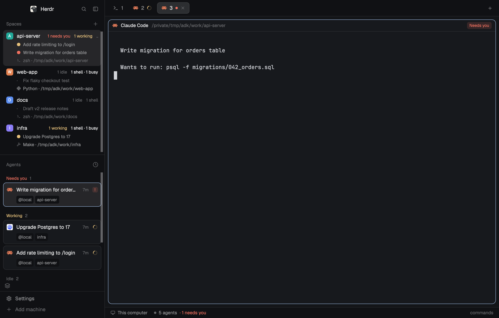
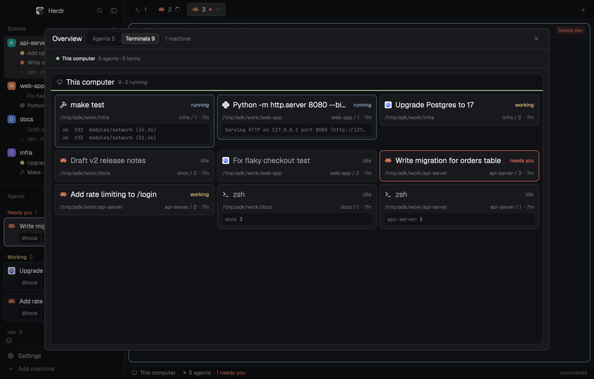

# herdr-agent-deck

A [Herdr](https://herdr.dev) layout: [`agent-deck`](agent-deck/RECIPE.md).

It shows every agent and terminal on every machine. Space rows list their chats, shells and running programs. Agents are cards, and hover cards work on the narrow rail. An Overview board (`⌘⇧O`) has one lane per agent state and one lane per machine for terminals, with each terminal's command and last output lines; its `Usage` button shows each machine's CPU, memory and disk use. Agents can carry labels (role, task, anything): they show as chips on the Overview's cards and at the right of each pane's header, a tag button beside `+` in the tab bar (or on any agent card) edits them with suggestions, and a task menu filters the Overview to one task. History (the search icon beside the Overview icon) finds past Claude Code sessions on every machine and reopens them; `herdr-resume://` links reopen a session from anywhere on your Mac.

| Main window | Overview: terminals |
| --- | --- |
|  |  |

## Install

Ask an agent in Herdr to add `github.com/zztalker/herdr-agent-deck/tree/main/agent-deck`, or by hand:

1. Copy `agent-deck/layouts/agent-deck.json` and `agent-deck/layouts/agent-deck-preview.png` (its picture in Settings) to `~/.config/herdr-app/layouts/` and each `agent-deck/mods/*` folder to `~/.config/herdr-app/mods/`.
2. Merge `agent-deck/keys.json` into `~/.config/herdr-app/keys.json` (it adds `cmd-shift-o`).
3. Run `herdr-app do layout.switch --name agent-deck`. `ctrl-shift-l` switches back.

**Resume links (macOS, optional):** run `resume-link/install.sh` so a click on a `herdr-resume://` link (Copy link in History or on a Claude Code card) opens that session in Herdr.

**Waiting:** agents at rest whose background shells still run (Claude Code's `run_in_background`) show as Waiting, in the Overview's Working lane. That needs the Claude Code hook from [herdr-agent-waiting-mod](https://github.com/zztalker/herdr-agent-waiting-mod) and an hc with `hc report` ([herdrdev/herdr-core#81](https://github.com/herdrdev/herdr-core/pull/81)); its `agents-waiting` mod isn't needed with this layout.

What it runs: `hc machine ls` and `hc read` (read-only). When you press `Usage`, `hc exec` runs a short read-only `sh` script on each machine (`/proc`, `top`/`vm_stat`, `df`). While History is open, `hc exec` runs a read-only scan of `~/.claude/projects` on each machine, keeping its own cache in `~/.cache/agent-deck-history/`; Copy link reads `~/.claude/sessions/<pid>.json`. It also runs `git` in each space's folder, on its machine (inherited from Herdr's Spaces). The one write outside that cache: `hc label` when you save in the label editor. No network.

Changes are listed in [`CHANGELOG.md`](CHANGELOG.md).

## License

Apache-2.0 (see `LICENSE`). `agent-deck-agents`, `agent-deck-spaces`, `agent-deck-tabs` and `agent-deck-pane` are modified from Herdr's shipped `agents`, `spaces`, `tabs` and `pane` mods (Apache-2.0). The changes are marked `agent-deck:` in the source. `agent-deck-labels/tag.svg` and `agent-deck-overview/link.svg` are Lucide icons (ISC).

History search and resume links follow the design of [Martin Krcho](https://github.com/martinkrcho)'s Herdr setup ([LinkedIn](https://www.linkedin.com/in/martinkrcho/)), including its `herdr-resume://` link format; the code is agent-deck's own.
