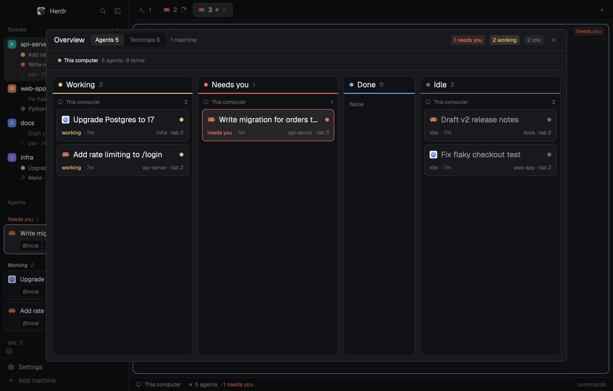

# herdr-agent-deck

A [Herdr](https://herdr.dev) layout: [`agent-deck`](agent-deck/RECIPE.md).

It shows every agent and terminal on every machine. Space rows list their chats, shells and running programs. Agents are cards, and hover cards work on the narrow rail. An Overview board (`⌘⇧O`) has one lane per agent state and one lane per machine for terminals, with each terminal's command and last output lines.

| Main window | Overview: terminals |
| --- | --- |
|  |  |

## Install

Ask an agent in Herdr to add `github.com/zztalker/herdr-agent-deck/tree/main/agent-deck`, or by hand:

1. Copy `agent-deck/layouts/agent-deck.json` and `agent-deck/layouts/agent-deck-preview.png` (its picture in Settings) to `~/.config/herdr-app/layouts/` and each `agent-deck/mods/*` folder to `~/.config/herdr-app/mods/`.
2. Merge `agent-deck/keys.json` into `~/.config/herdr-app/keys.json` (it adds `cmd-shift-o`).
3. Run `herdr-app do layout.switch --name agent-deck`. `ctrl-shift-l` switches back.

What it runs: `hc machine ls` and `hc read` (read-only). It also runs `git` in each space's folder, on its machine (inherited from Herdr's Spaces). No network, no writes.

## License

Apache-2.0 (see `LICENSE`). `agent-deck-agents` and `agent-deck-spaces` are modified from Herdr's shipped `agents` and `spaces` mods (Apache-2.0). The changes are marked `agent-deck:` in the source.
