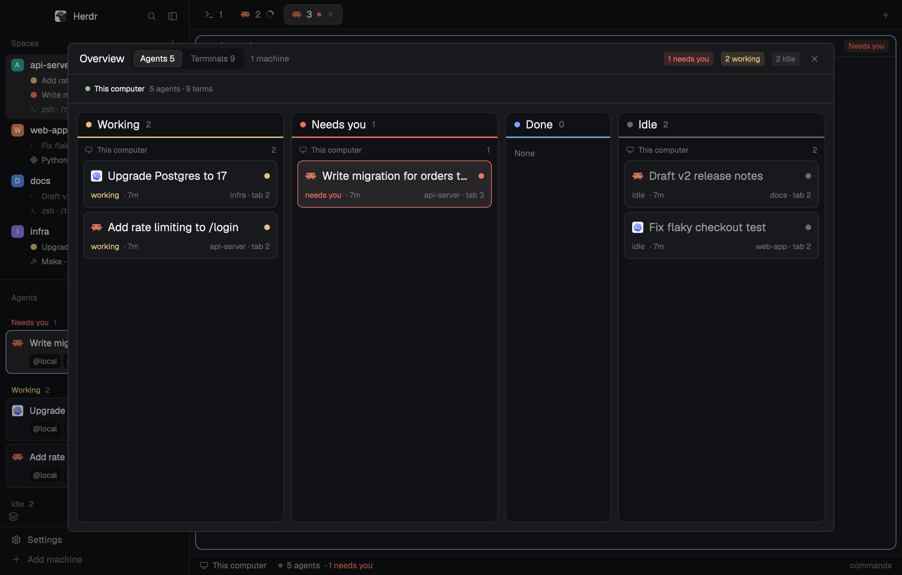

# Agent Deck

Herdr's main window rebuilt to show what every agent is doing on every machine. Spaces say what's inside them: chat names, status counts, open shells and running programs. Agents are two-line cards. On the narrow rail, resting the pointer on a row shows its wide card. A full-window Overview (`⌘⇧O`) lays out every agent as a board with one lane per state, and every terminal on every machine with its command and last output lines.

## What you see

**Sidebar (268px, `chrome` background), top to bottom:**

- **Brand bar** (46px): the shipped `workspace-chrome` mod.
- **Spaces** (half of the rest, min 90px):
  - **Machine header** (26px): one per machine when more than this computer is known, with:
    - a server/monitor icon and the name;
    - a red `N needs you` badge;
    - `N terms · M hidden` (tooltip: agents / other / hidden in no space);
    - `+` (new space there);
    - a 6px dot, `ansi2` when connected (tooltip: state and `hc` version);
    - a fold chevron.
  - **Space row:**
    - an 18px colored letter avatar and the name (max 150px);
    - git tail (repo/branch only when unusual, ↑ahead ↓behind);
    - status counts in status colors (`1 needs you`, `1 working`, `2 idle`);
    - `N shells · M busy`.
  - **Under the row**, up to 4 lines (11.5px) per kind, then `+N more`:
    - its agents' chat names, each with a status dot;
    - its shells/programs: program icon, program name, and the folder (or the program's own title while busy, unless that is a path, a prompt or just the terminal id).
- **Agents** (the other half, min 90px): grouped by space, or by priority (Needs you / Done / Working / Idle) with the sort menu. Each agent is a card (8px radius, `surface` background, `border`; focused: `selected` background and `accent` border):
  - **Line 1:** program icon, chat name (semibold), the fold chevron with sub-agent count, time in state (a pin on hover), status mark.
  - **Line 2:** chips `@machine` (`@local` here) and the space name.
- **Agents footer** (28px): a layers icon (Overview) on the left. On the rail it is 52px and stacks the layers icon over Herdr's `»` (widen the sidebar).
- **Sidebar footer** (69px): the shipped `workspace-chrome` footer.

**Narrow rail** (under 160px wide, 76px on macOS): spaces show their number and a status glyph; agents show a number and a status mark. Resting on any row for 250ms opens its wide card to the right:
- an agent card is 300px wide and includes its sub-agents;
- a space card is 320px wide.

The cards use `popover` background, `border` and `shadow_lg`.

**Main area:** the shipped tab bar (42px), panes, a `files`/`changes` panel (368px) and the `workspace-status` bar (28px). These are unchanged from Herdr's main layout.

**Overview:** a dialog at 85% × 85% of the window.
- **Title row** (44px): `Overview`, the tab switch `Agents N | Terminals N`, the machine count, status pills (Agents tab only) and a close button.
- **Machine strip:** one chip per machine with a connection dot, `N agents · N terms`; the tooltip shows the state, `hc` version and hidden terminals.
- **Agents tab:** four lanes, left to right:
  - **Working** (`working` color), **Needs you** (`blocked`), **Done** (`done`) and **Idle** (`idle`), each with a 2px colored underline and a count;
  - inside a lane, agents are grouped by machine (small header, count);
  - cards are at least 240px and wrap several to a line;
  - an empty lane shrinks to 150px and says `None`.
- **Terminals tab:** one lane per machine. The header shows the count, `N running` and `N hidden`; the underline is `ansi2` when connected. Cards are at least 260px. Each card shows:
  - the program icon;
  - the command as typed (`make test`), `zsh` for an idle shell, or the chat name for an agent;
  - a state word: `running` (accent), `idle`, or the agent's status;
  - the folder, `space / tab` (or `hidden` in `done` color) and its age;
  - the last 2 non-empty screen lines in the terminal font (an agent shows its last report message instead).

## How it behaves

**Status:**
- **working:** yellow dot, or a spinner in the Agents list.
- **blocked:** red: `needs you`, `!` in priority view, a red card border in the Overview.
- **done:** blue, until you look at it; then it is idle.
- **idle:** a grey ring or dot, with dimmed names.

**Clicks:**
- An agent card or row focuses its pane.
- A space row selects the space; right-click opens its menu; dragging reorders spaces.
- A machine header folds that machine.
- Overview:
  - an agent card runs `agent.focus` and closes the Overview;
  - a terminal card in a pane runs `pane.focus`;
  - a hidden terminal (in no space) runs `terminal.peek`.

**Keys and commands:**
- `⌘⇧O` (`mod.open:agent-deck-overview`) toggles the Overview; `Esc` closes it.
- `agent-deck-overview.agents` and `agent-deck-overview.terminals` switch its tab while it's open.
- The tab you used last is remembered.

**Refresh:**
- Machines: every 15s (Spaces) and 30s (Overview).
- Terminal output lines: every 8s, one `hc read` at a time, only while the Terminals tab shows.

## Built from

- **`layouts/agent-deck.json`:** a clone of Herdr's `main` layout with `spaces` → `agent-deck-spaces` and `agents` → `agent-deck-agents`.
- **`layouts/agent-deck-preview.png`:** the Settings picture (root `"preview"`): the Overview's Agents tab, 480×300 (1.6:1, the shape Settings cards show).
- **`mods/agent-deck-agents`:** modified from the shipped `agents` mod. It adds:
  - `label()`, which prefers the agent's own title (its chat name) when it is not a path, prompt or the program name;
  - the card row;
  - `HoverCard` (from `gpui-base`) around the rail row;
  - the footer button `run("mod.open", { name: "agent-deck-overview" })`.
- **`mods/agent-deck-spaces`:** modified from the shipped `spaces` mod. It adds:
  - helpers `chatName`, `counts`, `shellsIn` (terminal panes with no status that aren't agents), `busy` (not a shell) and `progIcon`;
  - the machine header badges;
  - `HoverCard` around the compact row.
  - It reads `agents()`, `panes()`, `terminals()` and `hc machine ls --json`.
- **`mods/agent-deck-overview`:** new, `mod.json` overlay `{ kind: "dialog", width: 0.85, height: 0.85 }`.
  - It reads `agents()`, `spaces()` (tab `working_since` / `changed_at` for time in state), `terminals()` (`foreground.argv`, `foreground.cwd`, `labels.where`, `created_ms`, `report.msg`) and `panes()`.
  - It runs `hc machine ls --json` and `hc read <address>`.
  - It uses `nextCommand()` for the tab commands.
- **`keys.json`:** `global` → `cmd-shift-o`.
- **Shipped mods used as-is:** `workspace-chrome` (also its SVG icons: server, monitor, layers, x, plus, chevron-down/right, pin, pin-off, branch, spinner, clock, check), `tabs`, `pane`, `files`, `changes`, `workspace-status`.

Runs programs and reads files:
- `hc` (read-only: `machine ls`, `read`).
- `agent-deck-spaces` keeps Herdr's own git tail from the shipped `spaces` mod. It runs `git` (`rev-parse`, `status`) in each space's folder, on that space's machine for remote spaces, and `watchFolder`s local repos' git folders to refresh on commits.
- No network, no writes.

## Watch out

- **Agent titles:** the chat name is the terminal title. Filter out titles that are a path (`~/…`, `/…`), a shell prompt (contains `@`) or the program name, or rows read `root@host:~`.
- **`hidden`** means the terminal is alive in the core but in no pane. Compute it from `panes()` terminals, not from `terminals()` alone.
- **Agent status:** use `agents()` status on Overview cards; the core's `status` keeps `done` after you've looked, while `agents()` turns it `idle`.
- **Agent previews:** an agent's screen is its own interface chrome. Show `report.msg`, not `hc read`.
- **Commands:** `foreground.argv[0]` can be a full path (`/Library/Developer/CommandLineTools/usr/bin/make`). Show its last path part.
- **Wrapped rows:** use `items_start()`, or cards of different heights drift.
- **`/private` prefix:** macOS reports `/private/tmp/…`. Strip `/private` before `/tmp` and `/var`, and show home as `~`.
- **IDs:** a `HoverCard` needs a stable id per row, and its trigger and content are slots, not children.
- **`close`:** don't name a View method `close`: Herdr calls a View's `close(cx)` itself when an overlay goes.
- **Base:** `agent-deck-spaces` is based on the shipped `spaces` of Herdr 0.1.11 (drag-reorder with a drop line and a same-machine guard). When a later Herdr changes that mod, re-apply the `agent-deck:` changes to the new one.
- **Wrapped cards:** `flex_1().min_w(N)` in a `flex_wrap()` row gives full-width cards that pair up once the lane is wide enough.

## Done when

- Two Claude Code agents in one space show their chat names under the space row, with status counts on it.
- A blocked agent turns its space count red, lands in the Needs you lane and has a red card border in the Overview.
- `make test` running in a shell shows `1 shell · 1 busy` on the space and a `make test` card marked `running` with its last 2 output lines under Terminals.
- With the sidebar dragged under 160px, resting on an agent number shows its card to the right within about ¼ second; clicking it focuses the agent.
- A terminal started with `hc run --bg` outside Herdr (in no space) shows on its machine lane as `hidden`; clicking it peeks.
- `⌘⇧O` opens the Overview and pressing it again closes it; with a remote machine added, its lane and strip chip show its `hc` version.
- `herdr-app check` passes for all three mods.
